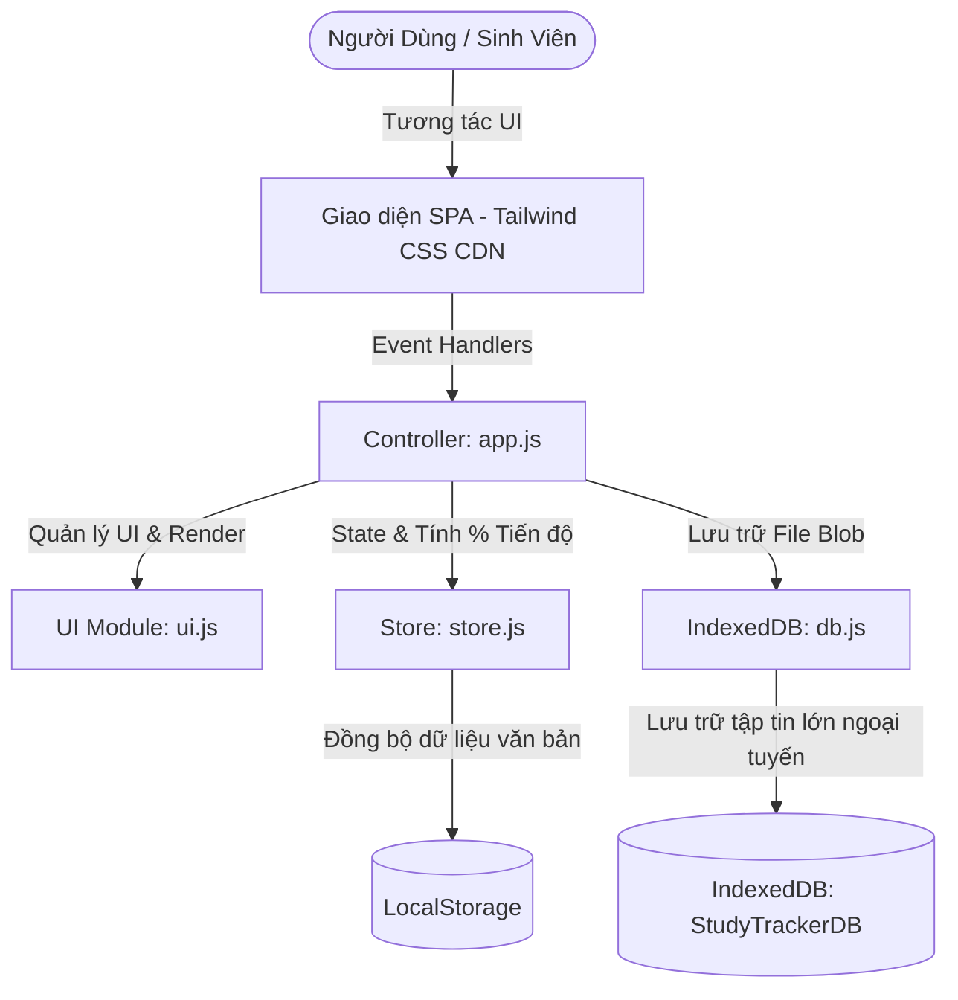

<div align="center">

# 🎓 Student Study Tracker (SPA)
### Hệ Thống Quản Lý & Theo Dõi Tiến Độ Học Tập Sinh Viên

[](https://opensource.org/licenses/MIT)
[](https://developer.mozilla.org/en-US/docs/Web/HTML)
[](https://tailwindcss.com/)
[](https://developer.mozilla.org/en-US/docs/Web/JavaScript)
[](https://developer.mozilla.org/en-US/docs/Web/API/IndexedDB_API)
[](#)

<p align="center">
  Một ứng dụng Single-Page Application (SPA) hiện đại, nhẹ, hoạt động 100% ngoại tuyến (Offline-First) giúp sinh viên đại học theo dõi môn học, tiến độ hoàn thành bài tập, đếm ngược thời gian học kỳ theo tuần và quản lý kho tài liệu an toàn trực tiếp trên trình duyệt.
</p>

[Tính Năng Chính](#-tính-năng-nổi-bật) • [Kiến Trúc Kỹ Thuật](#-kiến-trúc-hệ-thống) • [Cài Đặt & Chạy](#-cài-đặt--chạy-thử-nghiệm) • [Triển Khai](#-hướng-dẫn-deploy-miễn-phí)

</div>

---

## ✨ Tính Năng Nổi Bật

| Tính Năng | Mô Tả Chi Tiết |
| :--- | :--- |
| 📚 **Quản Lý Môn Học Toàn Diện** | Thêm, sửa, xóa môn học kèm thông tin: Mã môn, Tên môn, Số tín chỉ, Giảng viên giảng dạy, Ghi chú và Bảng màu phân loại trực quan. |
| ⏱️ **Tiến Trình Tuần Học (Week Tracker)** | Theo dõi thời gian môn học theo tuần (VD: Tuần 6/15 - Còn lại 9 tuần). Hỗ trợ nút tăng/giảm nhanh `[ - ]` / `[ + ]` và cảnh báo tự động khi sắp đến tuần thi cuối kỳ. |
| 📊 **Tiến Độ Bài Tập Động (Progress Bar)** | Tự động tính toán tỷ lệ hoàn thành `%` dựa trên số lượng bài tập/đồ án đã nộp của từng môn. |
| 📝 **Quản Lý Công Việc Theo Môn (Course Tasks)** | Phân loại đầu việc: *Bài tập (Assignment), Đồ án (Project), Đọc tài liệu (Reading), Ôn thi (Exam)* kèm ngày hạn nộp (Deadline). |
| ⚡ **Widget To-do List Toàn Cục** | Ghi chú nhanh các công việc cần làm trong ngày với 3 cấp độ ưu tiên *(Gấp, Vừa, Thấp)*, hỗ trợ hoàn thành và xóa nhanh. |
| 💾 **Kho Tài Liệu Ngoại Tuyến (IndexedDB)** | Kéo thả upload tài liệu học tập (PDF, Word, Ảnh, Zip,...). Lưu trữ dung lượng lớn trực tiếp vào **IndexedDB** thay vì bị giới hạn 5MB của LocalStorage, hỗ trợ tải về (Download) dạng Blob URL bất cứ lúc nào. |

---

## 🏗️ Kiến Trúc Hệ Thống (Architecture)

Ứng dụng được xây dựng theo triết lý **Pure Client Architecture** không phụ thuộc vào backend server phức tạp, tối ưu hóa tốc độ tải và đảm bảo quyền riêng tư dữ liệu của người dùng:



---

## 🛠️ Công Nghệ Sử Dụng (Tech Stack)

- **Frontend Core**: HTML5 Semantic, Modern CSS3
- **CSS Framework**: [Tailwind CSS](https://tailwindcss.com/) (CDN - Zero build step needed)
- **Programming Language**: Vanilla JavaScript (ES6+ Class, Async/Await, Modular Design)
- **Icons**: [Font Awesome 6 Pro/Free CDN](https://fontawesome.com/)
- **Client Storage**: 
  - `LocalStorage`: Lưu cấu trúc dữ liệu Môn học, Bài tập, To-do và Metadata.
  - `IndexedDB API`: Lưu trữ đối tượng File Blob lớn (PDF, DOCX, ZIP).
- **Test Engine**: Node.js Automated Test Runner (`test-suite.js` - 38/38 Test Cases Passed).

---

## 📁 Cấu Trúc Thư Mục (Folder Structure)

```
student-study-tracker/
├── index.html          # Trang SPA chính (Dashboard, Course Grid, Modals, Toast)
├── css/
│   └── custom.css      # Tùy biến thanh cuộn, hiệu ứng mờ kính (Glassmorphism), animations
├── js/
│   ├── db.js           # IndexedDB Wrapper quản lý lưu trữ offline File Blobs
│   ├── store.js        # Quản lý State Reactive (Môn học, Bài tập, Tuần học, To-do)
│   ├── ui.js           # Render UI Component, Progress bar, Toasts, Formatter
│   └── app.js          # Controller điều phối Upload/Download, Router ảo và sự kiện
├── server.js           # Máy chủ tĩnh Node.js phục vụ chạy preview cục bộ
├── test-suite.js       # Bộ test tự động kiểm tra cú pháp và logic nghiệp vụ
├── .gitignore          # Cấu hình bỏ qua tệp tạm thời
├── LICENSE             # Giấy phép mã nguồn mở MIT
└── README.md           # Tài liệu hướng dẫn dự án chi tiết
```

---

## 🚀 Cài Đặt & Chạy Thử Nghiệm (Quick Start)

Dự án không yêu cầu cài đặt build tool (Webpack/Vite) phức tạp. Bạn có thể chạy ngay bằng 1 trong 2 cách:

### Cách 1: Mở trực tiếp (Không cần cài đặt)
Chỉ cần nhấp đúp chuột vào file `index.html` bằng bất kỳ trình duyệt nào (Chrome, Edge, Firefox, Brave,...).

### Cách 2: Chạy qua Node.js Local Server
```bash
# Clone dự án về máy
git clone https://github.com/<your-username>/student-study-tracker.git

# Di chuyển vào thư mục dự án
cd student-study-tracker

# Khởi động server
node server.js
```
Truy cập: `http://localhost:3000`

---

## 🧪 Kiểm Thử Tự Động (Automated Testing)

Dự án tích hợp sẵn bộ kiểm thử tự động toàn diện kiểm tra tính toàn vẹn cú pháp và logic:

```bash
node test-suite.js
```

**Kết quả kiểm thử:**
```text
=== BẮT ĐẦU KIỂM THỬ TỰ ĐỘNG HỆ THỐNG QUẢN LÝ HỌC TẬP ===
  ✅ [PASS] Tệp tồn tại: index.html
  ✅ [PASS] Cú pháp hợp lệ, không có SyntaxError
  ✅ [PASS] Thêm môn học & tính toán tiến độ % bài tập chính xác
  ✅ [PASS] Tính năng đếm tuần môn học & phần trăm thời gian chính xác
  ✅ [PASS] Quản lý lưu trữ tài liệu ngoại tuyến IndexedDB
=== TỔNG KẾT: 38/38 TESTS ĐẠT YÊU CẦU (100% PASS) ===
```

---

## 🌐 Hướng Dẫn Deploy Miễn Phí (Deployment)

### Deploy lên GitHub Pages:
1. Đẩy mã nguồn lên GitHub repository của bạn.
2. Vào **Settings** $\rightarrow$ **Pages**.
3. Tại mục **Branch**, chọn nhánh `main` và thư mục `/ (root)`.
4. Bấm **Save** và nhận liên kết website chỉ sau 1 phút.

---

## 📄 Bản Quyền (License)

Dự án được phân phối dưới giấy phép **MIT License**. Bạn hoàn toàn có thể tự do sử dụng, chỉnh sửa và phát triển tiếp cho mục đích học tập hoặc cá nhân.

---

<div align="center">
  <sub>Xây dựng với ❤️ dành cho cộng đồng học tập sinh viên.</sub>
</div>
